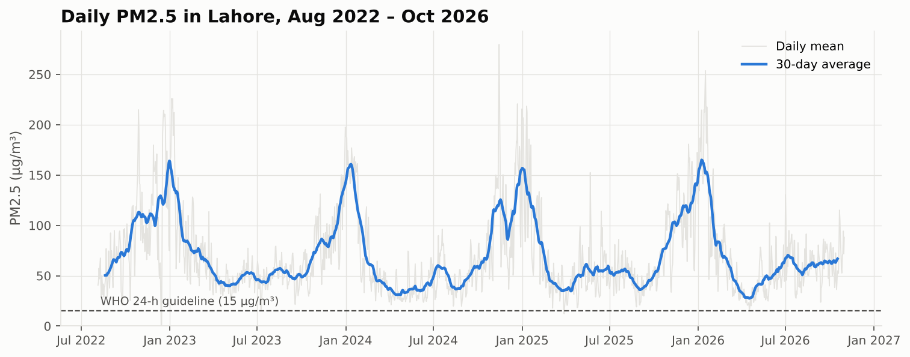
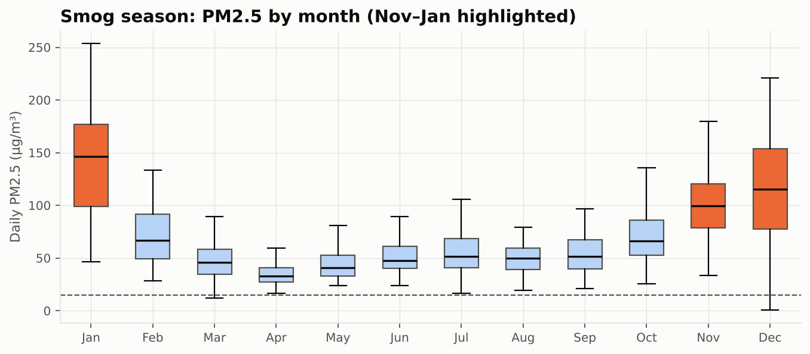
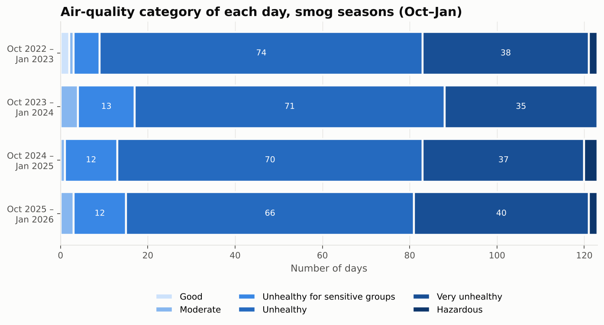
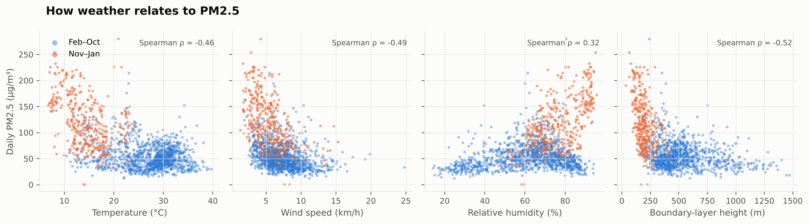
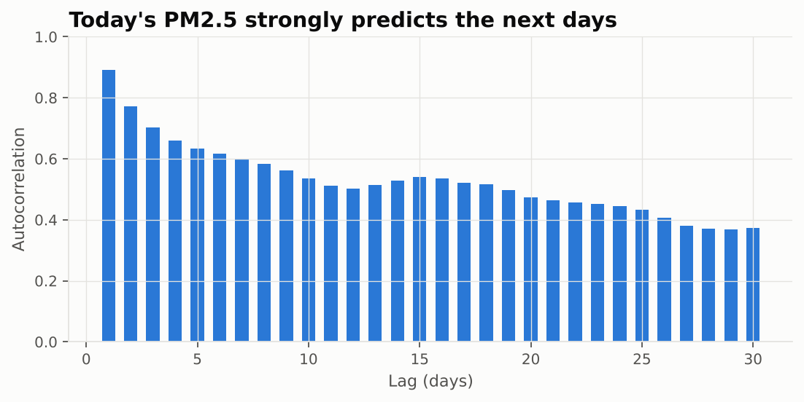
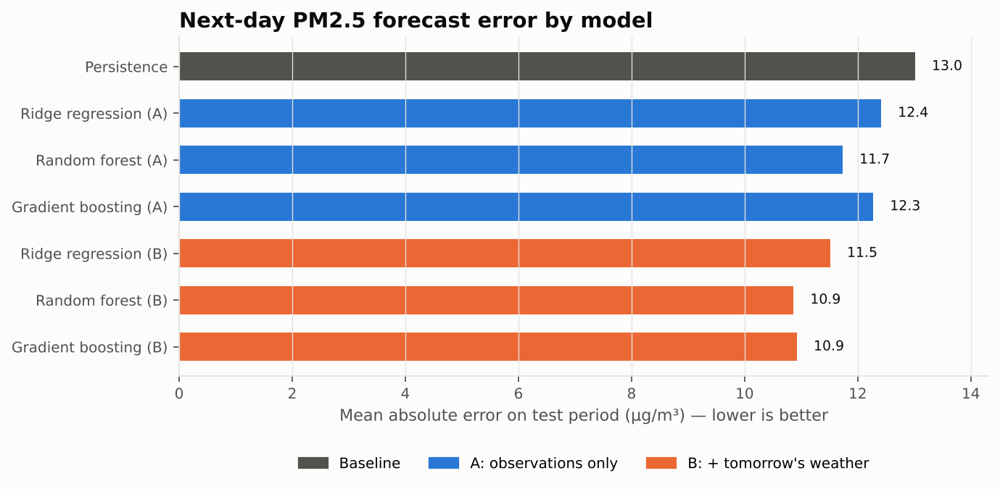
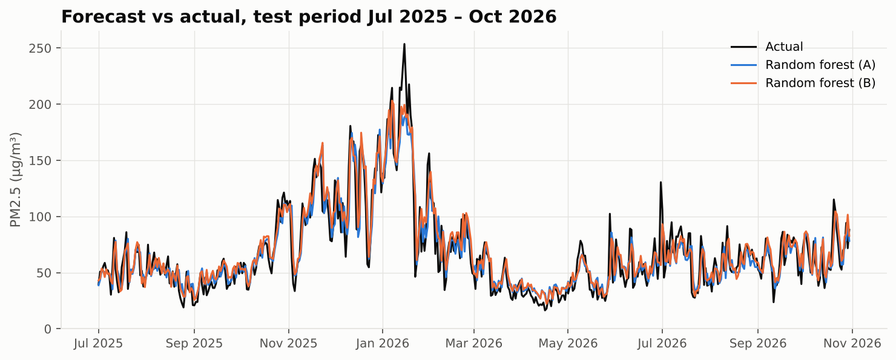
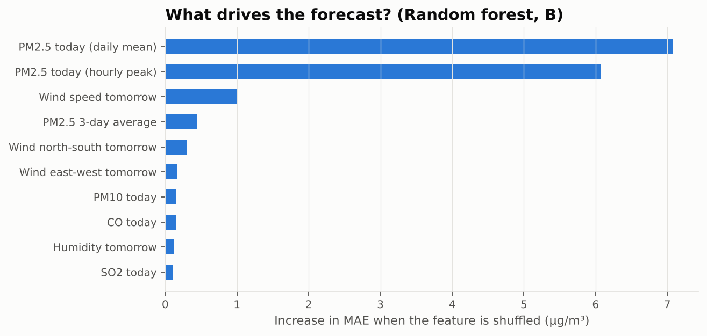

# Forecasting PM2.5 Smog in Lahore with Machine Learning and Weather Data

**Author:** Hafza Noor · [Portfolio](https://hafzanoor.github.io/portfolio/) · [GitHub](https://github.com/hafzanoor)

Lahore regularly ranks among the most polluted cities in the world, and every winter a
smog season disrupts schools, health and transport. This project uses four years of
hourly air-quality and weather data (Aug 2022 – Oct 2026) to:

1. **Describe** how severe and how seasonal Lahore's fine-particle (PM2.5) pollution is.
2. **Explain** which weather conditions go together with high-pollution days.
3. **Forecast** tomorrow's daily PM2.5 using machine learning, and test how much a weather
   forecast improves the prediction.

## Key findings

| | |
|---|---|
| Average daily PM2.5 | **69.9 µg/m³** — about 4.7× the WHO 24-hour guideline of 15 µg/m³ |
| Days above the WHO guideline | **99.7%** of 1,549 days |
| Worst month | **January** (mean 140.1 µg/m³), 3.9× the cleanest month (April, 35.5 µg/m³) |
| Smog season (Oct–Jan) | Each winter, **100+ of ~123 days** were "Unhealthy" or worse (US EPA AQI) |
| Strongest weather links | Low boundary-layer height (ρ = −0.52), low wind (ρ = −0.49), low temperature (ρ = −0.46) |
| Best forecast model | Random forest: **MAE 10.9 µg/m³**, R² = 0.85 — **16.5% lower error** than the "tomorrow = today" baseline, and **20% lower** during the Nov–Jan smog season |

## 1. Pollution is extreme and strongly seasonal



PM2.5 almost never drops to the WHO guideline. It climbs from October, peaks in
December–January, and falls by March. The pattern repeats every year.





In each of the four smog seasons, roughly 35–40 days were "Very unhealthy"
(125.5–225.4 µg/m³) and only a handful of days were "Good" or "Moderate".

## 2. Weather traps the pollution



Winter smog days (orange) are **cold, calm and humid, with a very shallow boundary layer**
(the layer of air near the ground where pollution mixes). When that layer is only
100–250 m deep, emissions from traffic, industry, brick kilns and crop-residue burning are
trapped close to the ground. Wind and a deeper mixing layer disperse them.



Pollution is also **persistent**: today's PM2.5 has a correlation of 0.89 with tomorrow's.
That makes "tomorrow = today" a strong baseline that any model has to beat.

## 3. Forecasting tomorrow's PM2.5

**Target:** daily mean PM2.5 for the next day.

**Two settings:**
- **A. Observations only:** today's PM2.5 (mean, hourly peak, recent averages), other
  pollutants (PM10, NO₂, CO, O₃, SO₂), today's weather, and the time of year.
- **B. With weather forecast:** setting A plus tomorrow's weather. Observed (reanalysis)
  weather stands in for a forecast, so B is an upper bound that assumes a perfect weather
  forecast.

**Models:** persistence baseline, Ridge regression, Random forest, Histogram gradient boosting
(scikit-learn).

**Validation:** chronological split, so the model never sees the future.
Training: Aug 2022 – Jun 2025 (1,055 days). Test: Jul 2025 – Oct 2026 (487 days), which
includes the full 2025–26 smog season.

| Setting | Model | MAE | RMSE | R² | MAE Nov–Jan | AQI category accuracy | MAE vs baseline |
|---|---|---|---|---|---|---|---|
| Baseline | Persistence (tomorrow = today) | 13.01 | 18.22 | 0.79 | 21.55 | 68.4% | — |
| A | Ridge regression | 12.41 | 17.21 | 0.81 | 20.19 | 68.8% | −4.6% |
| A | Random forest | 11.73 | 16.72 | 0.82 | 19.50 | 70.8% | −9.8% |
| A | Gradient boosting | 12.27 | 17.08 | 0.81 | 19.69 | 68.6% | −5.7% |
| B | Ridge regression | 11.51 | 15.56 | 0.84 | 17.52 | 72.3% | −11.5% |
| B | **Random forest** | **10.86** | 15.20 | 0.85 | 17.25 | 72.3% | **−16.5%** |
| B | Gradient boosting | 10.92 | **14.76** | **0.86** | **16.58** | **73.5%** | −16.0% |

*Errors in µg/m³. "AQI category accuracy" = share of days where the forecast falls in the
correct US EPA AQI band.*







**What the models learned:**
- Today's pollution level is by far the most important input. Pollution builds up and
  clears over several days.
- **Tomorrow's wind** is the most useful weather variable. Adding the weather forecast
  cuts error by a further ~7 percentage points, and helps most in the smog season, when
  a windy day can clear the air.
- Tree-based models beat linear regression, which suggests non-linear effects (for
  example, calm *and* cold together are much worse than either alone).

## Limitations and next steps

- **Data source.** PM2.5 comes from the CAMS atmospheric model, not from ground monitoring
  stations. CAMS captures the regional pattern well but may underestimate local peaks.
  A next step is to validate against ground monitors (e.g. US Consulate Lahore, Punjab EPA).
- **Perfect-forecast assumption.** Setting B uses observed weather. Real weather forecasts
  have errors, so real performance would sit between settings A and B.
- **Boundary-layer height** had a 6-month gap (Jan–Jun 2024) in the source data, so it is
  shown in the analysis but left out of the models. Filling this gap could improve results.
- **Extensions:** satellite fire counts (crop-residue burning in Punjab), multi-day
  forecasts (2–7 days), deep-learning sequence models (LSTM), and extending the analysis to
  other Punjab cities such as Multan and Faisalabad.

## How to run

```bash
pip install -r requirements.txt
python src/download_data.py   # only needed if data/raw/ is empty
python run_all.py             # prepare data -> analysis -> models (about 2 minutes)
```

## Project structure

```
├── data/
│   ├── raw/                  hourly CSVs from Open-Meteo
│   └── processed/            cleaned daily dataset
├── figures/                  all charts (01–08)
├── results/                  metrics, predictions, feature importance, summary stats
├── src/
│   ├── download_data.py      step 0: get the data
│   ├── prepare_data.py       step 1: clean, merge, aggregate to daily
│   ├── eda.py                step 2: exploratory analysis and charts
│   ├── forecast.py           step 3: feature engineering, models, evaluation
│   └── style.py              shared chart style
└── run_all.py
```

## Data sources

- Air quality: [Open-Meteo Air Quality API](https://open-meteo.com/en/docs/air-quality-api),
  based on the Copernicus Atmosphere Monitoring Service (CAMS) global model.
- Weather: [Open-Meteo Historical Weather API](https://open-meteo.com/en/docs/historical-weather-api),
  based on ECMWF ERA5 reanalysis.
- WHO Global Air Quality Guidelines (2021): 24-hour PM2.5 guideline of 15 µg/m³.
- US EPA Air Quality Index breakpoints for 24-hour PM2.5 (2024 revision).

## License

MIT. See [LICENSE](LICENSE).
